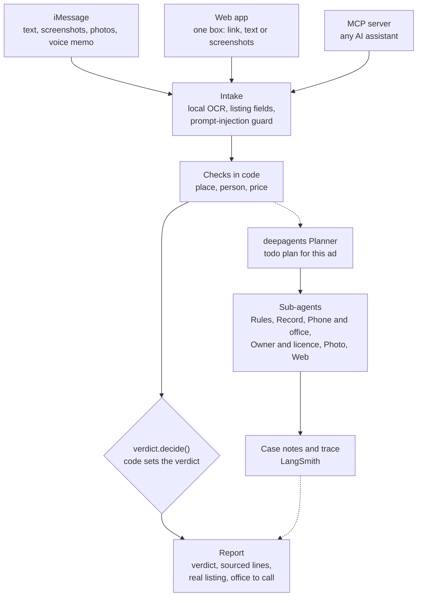

# SNAPBACK

**SNAPBACK checks a rental ad before you pay. Is it the real listing, and who do you call?**

Send SNAPBACK the ad you found, by iMessage or in the box on the web: a link, its text or
screenshots. It checks the place, the person and the price against the home's own record, gives
you a short report with one verdict, and hands you back to the real listing and the office on
record. Code sets every verdict. SNAPBACK never pays, books or sends anything for you.

[](https://github.com/DevSingh05/snapback/actions/workflows/ci.yml)


[Why](#why) · [What it checks](#what-it-checks) · [How it works](#how-it-works) ·
[Measured](#measured) · [Quickstart](#quickstart) · [Data and privacy](#data-and-privacy) ·
[Team](#team)

<!-- PENDING #314: /under-the-hood, one panel per technology with its measured numbers and a Show me link -->

## Why

In February 2025 a renter near Houston found a house on Craigslist, paid $2,200 in rent and
deposit, and moved in. Two days later the real owner, a rental company, said the person who took
the money did not own the house
(ABC13 Houston, Feb 15 2025).
The photos were of a real house. The person and the offer were fake, and the home's own record
could have shown it.

| Number                                                                                                | Source                                                                                                                                                                                       |
| ----------------------------------------------------------------------------------------------------- | -------------------------------------------------------------------------------------------------------------------------------------------------------------------------------------------- |
| Nearly **65,000** rental-scam reports and about **$65 million** lost, Jan 2020 to Jun 2025            | [FTC Data Spotlight, Dec 22 2025](https://www.ftc.gov/news-events/data-visualizations/data-spotlight/2025/12/rental-scams-hit-home-65-million-reported-losses)                               |
| That is about **32 reports a day**                                                                    | Our arithmetic on the FTC figure (65,000 reports over 2,008 days)                                                                                                                            |
| About half of rental scams in the 12 months to Jun 2025 began with a fake Facebook ad                 | FTC Data Spotlight, Dec 22 2025                                                                                                                                                              |
| **$275,110,419** lost by **12,368** people to real estate fraud in 2025, up 58 percent on 2024        | [FBI IC3 2025 Annual Report](https://www.ic3.gov/AnnualReport/Reports/2025_IC3Report.pdf) (published Apr 2026). This covers all real estate fraud, rentals included, not rentals alone       |
| About **$18.7 billion** a year in deposits, first month's rent and application fees, paid before keys | **Our estimate**: 10.2 million renter moves a year (Census HVS Q3 2026; 22 percent moved, ACS 2023 via Zillow) times about $1,835 paid up front (Zillow Consumer Housing Trends Report 2025) |

Reported losses are a floor. The FTC says its count "likely reflects only a fraction of the
actual harm". The money at risk is every deposit sent to someone met through an ad.

## What it checks

Every check reads one source, writes one line on the report, and names where its fact came from.
The report sorts them into three rows.

**The place: is this the real home?**

- **CoStar's record of the building.** The address, the units and floor plans, and whether the
  home is listed for sale on Homes.com while the ad offers it for rent.
- **The building's Matterport 3D scan.** The ad's photos are matched against the scan. The report
  says "Taken in this building (3 of 3 photos)" or "Taken in a different building. Red flag."
- **Vexcel aerial imagery**, shown on the place sheet as a picture of the building. It is evidence
  for you to look at and never changes the verdict (see [Measured](#measured)).

**The person: are you talking to the people who rent it?**

- **The phone against the office on record.** The ad's number is compared, as a keyed hash, with
  the leasing office in CoStar's record. The report says yes or no and never shows the digits.
- **The link against the building's website.** A lookalike link is a red flag.
- **Public records.** The county owner of record (Harris County, Houston houses), the Texas Real
  Estate Commission licence list, the Texas Comptroller's company check, HUD's manager record and
  the website's domain age. Each is a neutral line that names its source.
- **Here now.** You can ask the poster for a fresh photo of a spot in the home. A copy of a listing
  photo is caught.

**The price: is the deal or the ask a warning sign?**

- **Rent against the record.** The ad's rent is compared with the rents in CoStar's record and with
  HUD's typical rent for the ZIP code and bedroom count. Only a rent far below the building's
  lowest is flagged, so honest discounts pass.
- **The ad's own words.** Asks for money, papers or haste before a viewing: "Zelle before a
  viewing. Red flag."

**Then the hand-off.** The report shows the ad beside the real listing, with a "See the real
listing" link to it on Apartments.com, and the office on record to call. When a listing is being
copied, SNAPBACK drafts a note to that office. Every draft says "Draft, not sent. You send it."

The report gives one of four verdicts: **Hold off for now**, **Don't pay. Something here doesn't
match.**, **Could not place these photos** or **Checks passed. Still follow the two rules.** "Don't
pay" needs proof: a listing photo taken in a different property, or a reply that copies one of the
ad's own photos. A for-sale listing, a phone that isn't the office's or a name that isn't the
owner's holds the payment but never says "Don't pay" alone. SNAPBACK never calls a named person a
scammer.

## How it works



1. **Intake.** The ad arrives by iMessage (a Node sidecar on Photon 2.0, the Spectrum SDK), by the
   web app, or through the MCP server. Screenshots are read with local OCR, and the listing fields
   are pulled out behind a prompt-injection guard.
2. **The checks run in code.** Each one reads its source and returns evidence with its origin.
3. **`verdict.decide()`** in `src/snapback/verdict.py` turns that evidence into one verdict. It is
   the only place a verdict is chosen. No model sees or sets it.
4. **The deepagents Planner runs on every case,** in the background. It writes a todo plan, hands
   each check family to its own sub-agent, and each sub-agent has one read-only tool and writes its
   findings as notes in the agent file system. It explains the case and never moves it. The report
   never waits on it, and a hard time limit stops it.
   <!-- PENDING #316: the Planner's plan per ad, re-planned follow-ups for the card's gaps (up to 2 from a fixed menu), and one drafted next step -->
5. **The report.** The web report shows the verdict, the sourced lines, the ad beside the real
   listing and a check team you can watch work beside the 3D scan. A readable trace shows each
   member's model, tools, findings and time, and links out to the LangSmith run.

**In iMessage it is a conversation.** Photos get an instant "checking" line, then a short report
with a picture of the card: the verdict, the top two reasons and one next step. "Why?", "Who do I
call?", "Is it safe?" and "How did you check?" are answered from the same case without a new check.
It remembers your language, budget and beds for 30 days, and "forget me" deletes them. A voice memo
in gets a spoken reply of 15 seconds or less, which never reads out a phone number, a rent or a
link. Only allowlisted threads are answered, and it never texts first.

**MCP server.** `src/snapback/mcp_server.py` exposes SNAPBACK as tools for any agent:
`snapback_check_listing`, `snapback_get_verdict`, `snapback_why`, `snapback_what_to_do`,
`snapback_find_places`, `snapback_accept_preference`, `snapback_walk_summary` and
`snapback_draft_tour_request` (a draft only). It is a thin client over the
API, so every rule and verdict stays in code. Setup: [docs/mcp.md](docs/mcp.md).

**Ring finder.** One renter's check answers one ad. An investigator needs the ring behind many.
`src/snapback/forensics/` links ads by reworded text, shared photos, phone numbers and wordings,
groups them with Louvain communities, and gives every finding its evidence: ad ids, the matched
sentence, photo ids and a score. The investigator view at `/investigate` plays a 90-day stream day
by day, shows each ring forming and its time to detect, and exports a case file per group. It runs
on synthetic data only.

<!-- PENDING #313: the ring case file and a detector-grounded case study -->

| Path                         | What it is                                                                        |
| ---------------------------- | --------------------------------------------------------------------------------- |
| `src/snapback/verdict.py`    | Evidence in, verdict out. Pure code, no model                                     |
| `src/snapback/agent/`        | Case runner, intake, rules, deepagents graph and sub-agents, web checks, trace    |
| `src/snapback/adapters/`     | CoStar records, Matterport, Vexcel, Harris County owner roll, TREC, Texas records |
| `src/snapback/public/`       | HUD rents, Census address check, domain age (RDAP), reverse image search          |
| `src/snapback/vision/`       | Photo placement in 3D scans: DINOv2 retrieval, DISK and LightGlue, RANSAC         |
| `src/snapback/forensics/`    | The ring finder and its synthetic data generator                                  |
| `src/snapback/api/`          | FastAPI: cases, report, card image, trace stream, search, drafts                  |
| `src/snapback/mcp_server.py` | MCP server over the API                                                           |
| `apps/web/`                  | Vite, React and TypeScript web app                                                |
| `apps/sidecar/`              | iMessage sidecar on Photon 2.0, with voice                                        |

## Measured

Every number comes from merged code and its eval files. LIVE means real CoStar kit data or real
photos. FIXTURE means team-made data through the real pipeline. SYNTHETIC means generated data.

| What                                                                                                             | Result                                                                                                                                            | n                                  | Label     |
| ---------------------------------------------------------------------------------------------------------------- | ------------------------------------------------------------------------------------------------------------------------------------------------- | ---------------------------------- | --------- |
| Real listing photos placed in the right home (`eval/locate_real.csv`, #242; re-measured after #296, same counts) | 43 of 48 right home, 0 of 48 in a wrong home                                                                                                      | 48 photos                          | LIVE      |
| Decoy photos placed in the claimed building                                                                      | 0 of 30                                                                                                                                           | 30 decoys                          | LIVE      |
| Tamper test: a real listing with its phone changed, "Zelle before the tour" added, or a lookalike link           | Each change caught 6 of 6 on real photos and 2 of 2 on scan renders                                                                               | 6 photos and 2 renders, per change | LIVE      |
| Batch run: composed ads and labelled messages through the real pipeline (`eval/ads_results.csv`, #262)           | 117 of 123 handled as expected, including 43 of 43 clean messages left alone                                                                      | 123                                | FIXTURE   |
| Deep agent in the background (#273, real model runs)                                                             | Report returns in 0.03 to 0.09 s without waiting; agent done in a median 22.9 s, no fallbacks                                                     | 6 cases, 5 timed runs              | FIXTURE   |
| Ring finder over a 90-day stream of 3,039 ads with 10 seeded rings (#293)                                        | 10 of 10 rings flagged, median 3 days after a ring's first ad; 0 of 2,684 honest ads flagged                                                      | 10 rings, 2,684 honest ads         | SYNTHETIC |
| Ring finder on a 301-ad corpus with 4 seeded rings                                                               | 4 of 4 rings, 0 of 244 honest ads flagged; a keyword search found 0 of 4                                                                          | 301 ads                            | SYNTHETIC |
| Vexcel aerial matcher, including next-door buildings (`eval/vexcel/results.json`, #308)                          | 17 of 28 against a bar of 18 of 20: it told every next-door and wrong building apart (16 of 16) but recognised the right building in only 1 of 12 | 28 cases                           | LIVE      |

<!-- PENDING #312: | Ring finder on reworded ads, with the phone and photo-link fallback on | 9 of 10 rings; 0 of 2,684 honest ads flagged | 10 rings | SYNTHETIC | -->

**What the numbers mean, and where they stop.**

- **Aerials are evidence only.** The Vexcel matcher compares perceptual hashes, and a shifted view
  of the same building looks like the building next door. It missed the bar, so the aerial stays a
  picture on the place sheet and the switch that would let it hold a payment stays off. Matching
  building footprints is next.
  <!-- PENDING Vexcel v2: footprint matching result -->
- **Right home, not right room.** Photo placement is scored by home. The room is not measured, and
  we don't claim it.
- **Mirrored photos mostly stop matching** (4 of 18 placed, LIVE). They were never placed in a
  wrong home, and the other checks still run.
- **Not every home has a scan or a record.** Without a scan the photo row says "Not checked", and
  the person and price rows run on public records. HUD's rent cutoff is not measured yet.
- **Houston and Texas first.** Search, the owner roll and the licence list cover Houston and Texas.
- **The ring finder is tested on data built alongside it,** so its numbers show the method works
  on rings shaped like these. They are not an accuracy claim for real listings.

## Quickstart

Needs [uv](https://docs.astral.sh/uv/), Python 3.12, Node 22 and npm.

```bash
make setup               # uv sync + npm install
cp .env.example .env     # fixture mode by default; needs no keys
make api                 # API on http://localhost:8000
make web                 # web app on http://localhost:5173, in a second terminal
```

Fixture mode (`SNAPBACK_DATA_SOURCE=fixture`, the default) runs on synthetic, team-made data, and
every screen and number says FIXTURE. To see staged cases end to end:

```bash
uv run python -m snapback.agent.demo   # prints the staged cards
DEMO_CASE=b make api                   # every new case runs on staged case b
```

Optional extras: `uv sync --extra intake` adds local OCR for screenshots, `--extra agent` adds the
deepagents Planner, and `--extra vision` adds the photo matcher (torch, kornia, FAISS, OpenCV).
`make sidecar` runs the iMessage sidecar and `make mcp` runs the MCP server on stdio.

`make check` runs what CI runs: the repo hygiene guard, ruff, ESLint, Prettier, TypeScript, pytest
and the web and sidecar tests. `make eval` writes `eval/results.csv` and runs the regression gate.

**Environment variables.** Names only; put values in `.env`, which is never committed.
`.env.example` documents most of them, and `src/snapback/settings.py` has the rest.

| For                         | Variables                                                                                                                                       |
| --------------------------- | ----------------------------------------------------------------------------------------------------------------------------------------------- |
| Mode                        | `SNAPBACK_DATA_SOURCE`, `DEMO_CASE`, `SNAPBACK_SHOW_RECORD_FIGURES`                                                                             |
| Deep agent and tracing      | `SNAPBACK_AGENT`, `ANTHROPIC_API_KEY`, `LANGSMITH_API_KEY`, `LANGSMITH_PROJECT`                                                                 |
| CoStar kit and its partners | `COSTAR_KIT_URL`, `COSTAR_KIT_ZIP`, `COSTAR_ZIP_PASSWORD`, `MATTERPORT_API_KEY`, `MATTERPORT_API_TOKEN`, `VEXCEL_API_KEY`                       |
| Web checks                  | `SNAPBACK_WEB_CHECKS`, `BRIGHTDATA_API_TOKEN`, `APIFY_TOKEN`, `BROWSER_USE_API_KEY`, `SERPAPI_API_KEY`                                          |
| iMessage and voice          | `SPECTRUM_PROJECT_ID`, `SPECTRUM_PROJECT_SECRET`, `SIDECAR_ALLOWED_THREADS`, `SIDECAR_RENTER_SALT`, `ELEVENLABS_API_KEY`, `ELEVENLABS_VOICE_ID` |
| Safety                      | `SNAPBACK_PHONE_SALT`, `SNAPBACK_DAILY_LIMIT`                                                                                                   |

**LIVE mode** (`SNAPBACK_DATA_SOURCE=live`) reads the CoStar kit from `data/` with your own keys.
Each person accepts the kit's terms for themselves. `python3 scripts/probe_kit.py` prints field
names and counts only, never record values.

## Data and privacy

The full account is in [DATA_USE.md](DATA_USE.md).

| Where it goes                                | What is sent                                                                                                                                           |
| -------------------------------------------- | ------------------------------------------------------------------------------------------------------------------------------------------------------ |
| Stays on our machine                         | CoStar kit records, Matterport scans and Vexcel imagery. Photo matching and OCR run locally                                                            |
| The language model (Anthropic Claude)        | The renter's own text and yes/no facts the code derived. Never kit rows, record figures, photos or addresses                                           |
| LangSmith                                    | The deep agent's trace: the same text and derived facts the model saw                                                                                  |
| Web checks (Bright Data, Apify, Browser Use) | Small derived values: the record's website host, the ad link's host, a short phrase of the ad with no contact details, the rounded area, the bed count |
| Reverse image search (SerpApi)               | At most 2 public photo links found in the ad text. Never an uploaded file                                                                              |
| ElevenLabs                                   | The voice memo, and the spoken reply's text (which never holds a phone number, a rent or a link)                                                       |
| Photon (iMessage)                            | The messages in allowlisted threads. Thread ids are kept as keyed hashes                                                                               |

- **CoStar record figures never go to an outside model.** Rents and unit counts from the record
  show only on a local LIVE demo with `SNAPBACK_SHOW_RECORD_FIGURES` on, never on a public host, the
  card image, MCP or iMessage. The "See the real listing" link shows either way.
- **Sponsor data stays in `data/`,** which is git-ignored. `make hygiene` fails if anything there is
  tracked, and the kit is deleted by the date its terms set (Nov 15 2026, 16:00).
- **Phone numbers are compared as keyed hashes,** and the report says yes or no, never the digits.
  Every phone number in the fixtures is a 555 number.
- **Names stay out.** A private owner reads "a private owner". A company is named only when it
  matches one we already know. No real addresses or renter names are in code, fixtures, tests or
  docs.
- **Photos are kept as hashes, never pixels,** for 7 days.
- **Delete anytime.** `make purge` deletes everything in `data/`. To remove one renter's cases:

  ```bash
  uv run python -m snapback.safety delete-case <case_id>
  uv run python -m snapback.safety delete-renter <renter_id>
  ```

## Team

- Vidyut ([@vs-githjk](https://github.com/vs-githjk))
- Dev ([@DevSingh05](https://github.com/DevSingh05))
- Jeffrey ([@jeffrey-g05](https://github.com/jeffrey-g05))
- Rishit ([@RishitRai](https://github.com/RishitRai))

**Built on:** CoStar property records and Homes.com listings, Matterport 3D scans and Vexcel aerial
imagery from the CoStar kit, used under its terms; LangChain deepagents and LangSmith; Photon 2.0
(the Spectrum SDK) for iMessage; Anthropic Claude; ElevenLabs; Bright Data, Apify and Browser Use;
SerpApi. Arlequin AI's forensics brief shaped the ring finder. Public data from the Harris County
Appraisal District, the Texas Real Estate Commission, the Texas Comptroller, HUD, the US Census
Bureau and the City of Houston. Models and libraries: DINOv2 (Meta, Apache 2.0), DISK and
LightGlue through kornia (Apache 2.0), RapidOCR on ONNX Runtime, MapLibre.

Read [AGENTS.md](AGENTS.md) before contributing. It holds the hard rules: no sponsor data or
secrets in git, code sets the verdict, LIVE or FIXTURE on everything, no number before it is
measured, and never call a named person a scammer.

## What a realtor said

A realtor reviewed SNAPBACK as rental tour prep, with scam safety built in: find a place, see it on
the map, walk it in 3D before you go, and check the ad before any money moves.

> "If he can add in additional safety features for preventing further scams and financial scams, I
> think this would be a very good app to have in the marketplace."
>
> Ashwin Veeravalli, Realtor, The Agency, Los Gatos CA

## Rights

Rights in this project are assigned to CoStar Realty Information, Inc. under the HackPrinceton Fall
2026 hackathon agreement. No licence is granted. Third-party libraries remain under their own
licences.
