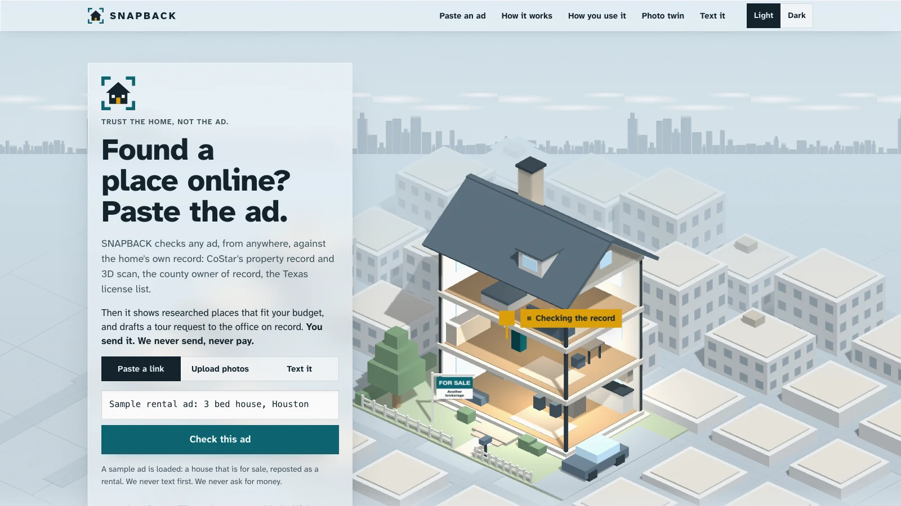
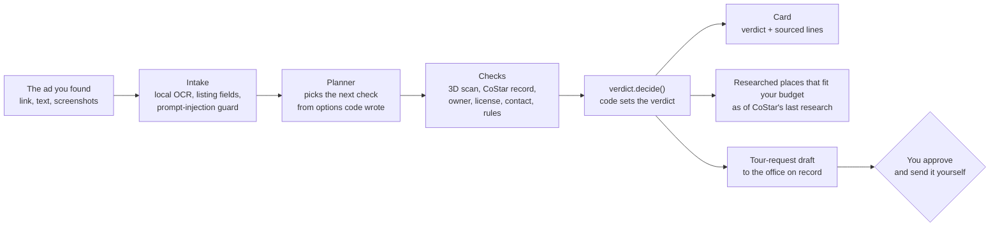
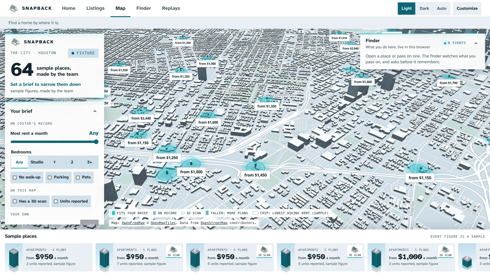
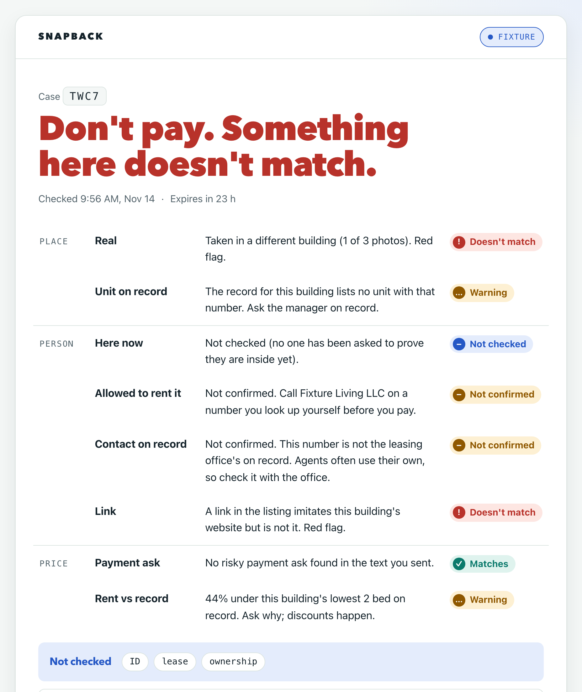
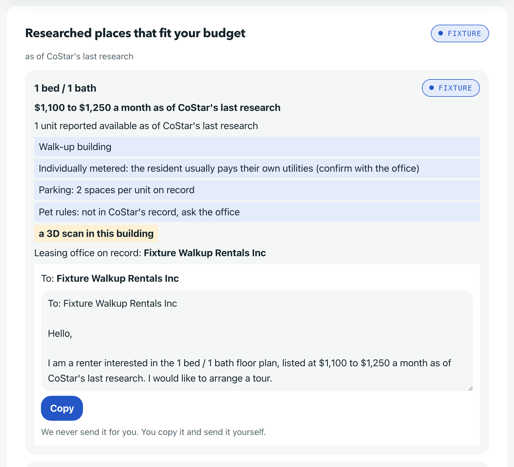
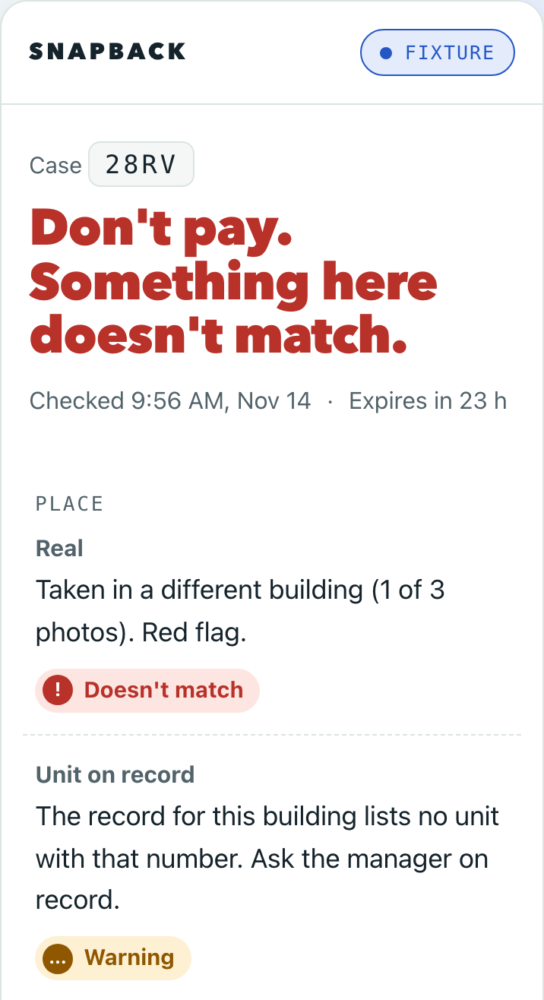

<div align="center">

# SNAPBACK

**Trust the home, not the ad.**

Paste a rental ad you found online. SNAPBACK checks it against the home's own record, then shows
researched places that fit your budget.

[](https://github.com/DevSingh05/snapback/actions/workflows/ci.yml)


[About](#about) · [How it works](#how-it-works) · [Screenshots](#screenshots) ·
[Quickstart](#quickstart) · [Limits and status](#limits-and-status)



<sub>The first screen: paste the ad you found, in a link, photos or text. The house is the
place being checked. Sample ad, fixture data made by the team.</sub>

</div>

## About

SNAPBACK is a renter's agent for anyone about to pay for a home they found online. Paste the ad
and it checks it against the home's own record: the CoStar property record, the building's
Matterport 3D scan and Vexcel aerial imagery, plus the county owner of record and the Texas license
list. Then it shows researched places from CoStar's Houston listings that fit your budget, and
drafts a tour request to the leasing office on record. Code, not a language model, sets every
verdict. SNAPBACK never pays, books or sends anything; you approve and send any message yourself.

## Why

In February 2025 a renter in the Houston area found a house on Craigslist, paid $2,200 and moved
in. Two days later the home's real owner, a rental company, said the person who took the money did
not own it
([ABC13, Feb 15 2025](https://abc13.com/post/conroe-woman-loses-2200-fears-homelessness-renting-home-landlord-did-not-own-property/15907951/)).
The FTC counted nearly 65,000 rental-scam reports from January 2020 to June 2025, and about half of
the people who reported one said it started with a fake ad on Facebook
([FTC Data Spotlight, Dec 2025](https://www.ftc.gov/news-events/data-visualizations/data-spotlight/2025/12/rental-scams-hit-home-65-million-reported-losses)).
Ads like these use real photos of real homes, so the photos pass. The person and the offer are
fake, and the home's own record can show that.

## How it works



1. **Intake** reads the ad's text and screenshots with local OCR and pulls out the listing fields.
2. **The planner** picks which check runs next, from a list that code writes. By default the
   planner is code. With `SNAPBACK_AGENT=deepagents` a model picks the order, and each step on the
   live trace is stamped with who picked it. Every check that can run still runs.
3. **The checks** compare the ad with the home's record. The 3D scan says which building the photos
   were taken in. The record says who is on record and whether the home is for sale.
4. **`verdict.decide()`** in `src/snapback/verdict.py` turns the evidence into one verdict. It is
   the only place a verdict is chosen, and no model ever sees or sets it.
5. **You decide what is sent.** The proof-of-presence challenge and the tour request are drafts.
   SNAPBACK never texts anyone for you; you approve and send any message yourself.

## What it checks

Each check reads one source, writes one line on the card, and says where the fact came from.
"Merged" means it is on `main` and covered by tests in CI.

| Check                             | Data it reads                                                      | What the card says                                                                                                                             | Status                                                |
| --------------------------------- | ------------------------------------------------------------------ | ---------------------------------------------------------------------------------------------------------------------------------------------- | ----------------------------------------------------- |
| Photos taken in this home         | Matterport 3D scan of the building                                 | "Taken in this building (3 of 3 photos)" or "Taken in a different building (1 of 3 photos). Red flag."                                         | Merged. Runs where the scan is indexed on the machine |
| For sale, posted as a rental      | Homes.com listings in the CoStar kit                               | "Listed for sale on Homes.com by (brokerage) since (date)", and to confirm with that brokerage before paying                                   | Merged                                                |
| Owner of record                   | Harris County Appraisal District record (Houston houses only)      | "Owner of record: (company), not the poster", plus that owner's own published rule on where it takes applications                              | Merged                                                |
| Agent license                     | Texas Real Estate Commission (TREC) public license data            | "Licensed in Texas", or that a license number in the ad has no active license                                                                  | Merged                                                |
| Contact on record                 | CoStar property record: manager, leasing office phone, website     | "This number is not the leasing office's on record", or "A link in the listing imitates this building's website"                               | Merged                                                |
| Unit and rent vs record           | CoStar property record: units and asking rents                     | "The record for this building lists no unit with that number", or "Below the rents on record for this building. Ask why; discounts happen."    | Merged                                                |
| Payment, data and pressure asks   | The ad's own text                                                  | "Zelle before a viewing. Red flag.", "Social Security number before a viewing. Red flag."                                                      | Merged                                                |
| Here now                          | A fresh reply photo from the poster, compared with the ad's photos | "The reply is a copy of listing photo 2. Red flag."                                                                                            | Merged                                                |
| Aerial view                       | Vexcel aerial imagery                                              | A picture of the claimed building beside the building the photos were placed in. It never changes the verdict.                                 | Merged                                                |
| Places that fit your budget       | CoStar kit: Houston apartment floor plans and house rentals        | Researched places with asking prices "as of CoStar's last research", picked and ordered by code (no model). `POST /search` returns places only | Merged (API and search screen)                        |
| Tour request                      | The leasing office on record in the CoStar property record         | A draft to that office for you to send yourself, from `POST /cases/{id}/tour-draft` (needs a case and its write token)                         | Merged                                                |
| Report this copy                  | The card's listing and record lines                                | An evidence pack a listing agent can take to the platform, from `GET /cases/{id}/report`                                                       | API merged. No button in the app yet                  |
| The ad says X, the record shows Y | CoStar kit: room labels, listing features, amenities               | An information line, labelled "as of CoStar's last research"                                                                                   | In progress                                           |
| "New management", "just sold"     | CoStar kit: property manager start dates, sale records             | An information line. It never changes the verdict by itself                                                                                    | In progress                                           |

The card answers with one of four verdicts: **Hold off for now**, **Don't pay. Something here
doesn't match.**, **Could not place these photos** or **Checks passed. Still follow the two
rules.** Don't pay needs proof: a listing photo taken in a different property, or a reply that
copies one of the ad's own photos. A for-sale listing, a phone that is not the office's or a name
that is not the owner's never says Don't pay by itself, and SNAPBACK never calls a named person a
scammer. Cards come as a web page and as a PNG with a verify link.

## Screenshots

<p align="center">
  
  <br />
  <sub>The map: sample places stand as columns on the city, with the lowest asking rent on each.</sub>
</p>

<table>
  <tr>
    <td width="50%" valign="top"></td>
    <td width="50%" valign="top"></td>
  </tr>
  <tr>
    <td valign="top"><sub>The card. One photo was taken in a different building, so it says Don't pay.</sub></td>
    <td valign="top"><sub>Researched places in budget (a separate search), with a tour request you send yourself.</sub></td>
  </tr>
</table>

<p align="center">
  
  <br />
  <sub>The card for the same staged ad, on a phone.</sub>
</p>

<sub>Every screenshot is the web app running locally on synthetic fixture data made by the team,
and each screen says FIXTURE. Office names such as "Fixture Living LLC" are made up.</sub>

## Quickstart

Needs [uv](https://docs.astral.sh/uv/), Python 3.12 and Node 22.

```bash
make setup               # python and node dependencies
cp .env.example .env     # fixture mode by default; needs no keys
make api                 # API on http://localhost:8000
make web                 # web app on http://localhost:5173, in a second terminal
```

`make check` runs the repo hygiene guard, ruff, ESLint, Prettier, TypeScript, pytest, and the web
and sidecar tests. CI runs all of that, plus the eval gate and the web build (`npm run build`).

Optional extras: `uv sync --extra intake` adds local OCR for screenshots, `--extra agent` adds the
deepagents planner, and `--extra vision` adds the photo locator (torch, kornia, faiss, OpenCV).

**Staged cases** in `fixtures/demo/` run end to end: three made-up ads and two replays of reported
cases. Each card made from them says "Staged example" in its footer.

```bash
uv run python -m snapback.agent.demo   # prints all five cards
DEMO_CASE=b make api                   # every new case runs on staged case b (a, b or c)
```

| Case | The staged ad                                                           | The card                                               |
| ---- | ----------------------------------------------------------------------- | ------------------------------------------------------ |
| `a`  | Real building, wrong unit, low rent, lookalike link, copied reply photo | Don't pay: the reply is a copy of listing photo 2      |
| `b`  | The same ad, with one photo taken in a different building               | Don't pay: a photo was taken in a different property   |
| `c`  | A house listed for sale, posted as a rental, with no scan               | Hold off: listed for sale; confirm with that brokerage |

The two replays, in `demo/replays/`, follow cases reported in the news: a move-in paid to a poster
who did not own the house, and a Zelle deposit for a house that was never for rent. Both end in
Hold off.

### Live mode (the CoStar kit)

`SNAPBACK_DATA_SOURCE=fixture` (the default) runs on synthetic, team-made data.
`SNAPBACK_DATA_SOURCE=live` reads the CoStar kit from `data/` and the sponsor APIs with your own
keys. Every screen, card and number says LIVE or FIXTURE.

1. Open the kit portal at https://beta-app.matterport.com/2026-princeton-hackathon and accept the
   terms. Each person accepts for themselves.
2. Get your own sponsor keys from the CoStar Discord (`/costar-keys` in `#costar-group`) and put
   them in `.env` only. The names are in `.env.example`.
3. Unzip the kit under `data/`, for example `data/raw/costar/costar-hackathon-kit/`.
4. Run `python3 scripts/probe_kit.py`. It prints field names and counts only, never record values.

### Integrations

- **MCP server.** Any AI assistant (Claude Desktop, Claude Code, others) can call SNAPBACK to
  check a rental ad, ask why, and get what to do next, with the verdict set by code and a link
  back to the real listing. Setup and a demo script: [docs/mcp.md](docs/mcp.md).

## Architecture

| Path                        | What it is                                                                 | Lane |
| --------------------------- | -------------------------------------------------------------------------- | ---- |
| `src/snapback/verdict.py`   | Evidence in, verdict out. Pure code, no model                              | A    |
| `src/snapback/agent/`       | Case runner, planner, intake, rules (price, unit, payment, contact, owner) | A    |
| `src/snapback/search.py`    | Places that fit a budget, from CoStar's researched listings                | A    |
| `src/snapback/api/`         | FastAPI: cases, card, PNG, trace stream, search, tour draft, report pack   | A    |
| `src/snapback/card/`        | Card strings and the PNG card                                              | A    |
| `src/snapback/vision/`      | Photo locator over 3D scans, photo memory, recapture model                 | V    |
| `src/snapback/eval/`        | Eval harness and the locate gate                                           | V    |
| `src/snapback/adapters/`    | CoStar, Homes.com, Matterport, Vexcel, county owner record, Texas license  | D    |
| `src/snapback/challenge/`   | Proof-of-presence challenge: spots, codes, local OCR                       | D    |
| `src/snapback/safety/`      | Daily limits, delete and purge                                             | D    |
| `src/snapback/contracts.py` | Shared data shapes every lane reads and writes                             | XO   |
| `apps/web/`                 | Vite, React and TypeScript web app                                         | T    |
| `apps/sidecar/`             | iMessage intake handler                                                    | D    |
| `fixtures/`, `tests/`       | Synthetic, team-made data and the Python tests                             | all  |

Lanes: A agent and backend, T front end, V vision and ML, D data and iMessage. Owners are in
[docs/ROLES.md](docs/ROLES.md).

## Limits and status

- **Photo accuracy on real ad photos is not measured yet.** That run (A8) waits on access to the
  kit's listing photos. No accuracy number appears here, in the demo or on a card until the
  harness measures it, with n shown.
- **Numbers so far are on renders, not photos.** The locate gate is measured on renders of the
  scans, and every line it prints says so. On renders of our scans (unseen directions from the
  indexed scan points), n=20 claimed + 10 other-building views: 20/20 placed in the right
  building, 0 false placements (held-out seed, main 04b9937, #28). Three demo houses are now indexed beside the apartment
  scans; house results so far are on renders too.
- **Houston only.** Search covers CoStar's Houston listings.
- **Owner of record and license: Houston/Texas only.** The owner comes from the Harris County record
  (Houston houses only), and the license check uses Texas (TREC) data.
- **The data is as of CoStar's last research.** Nothing is called "available now", and lease
  status is not public, so "recently rented" is information, never a flag.
- **A scan shows a floor plan, not a unit.** Apartment scans are model units, so a match says "this
  building, this floor plan", never a unit number.
- **SNAPBACK never pays, books or sends anything for you.** Tour requests and challenges are drafts
  you send yourself. iMessage intake is a tested handler, but the bridge is not connected yet.
- **A model never sets a verdict.** It can pick the order of checks and write an explanation. A
  recapture model for reply photos exists, is off by default, and its score never says Don't pay.
- **A code on a reply photo is not proof.** The local reader can miss handwriting, so a wrong or
  missing code asks again and then holds.
- **The web replay page still shows a fictional replay,** labelled so. The two replays of reported
  cases run as staged cases from the command line and are not on the web page yet.

## Evaluation

`make eval` writes `eval/results.csv` with aggregate numbers only (condition, metric, n, rate,
interval) and runs a regression gate against `eval/baseline.csv`. The API serves the same file at
`GET /eval/results.csv`, and its first line says FIXTURE or LIVE. Today its case-bank rows are
synthetic and labelled FIXTURE, and its locate calibration rows were measured on renders of our
scans and say so. Neither is accuracy on real ad photos, so this README quotes no accuracy number.

## Forensics (Arlequin track)

The investigator view at `/investigate` (API: `GET /forensics/rings`, `GET /forensics/rings/{id}`,
`POST /forensics/ask`). One renter's check answers one ad; an investigator needs the ring behind
many. **All data here is SYNTHETIC and FIXTURE**: about 300 generated rental ads in a made-up city
(`fixtures/forensics/`, made by `uv run python -m snapback.forensics.generate`, seeded, same seed
same bytes), 555 phone numbers, perceptual-hash-like photo ids. No CoStar, Matterport or Vexcel
data, no real address or number.

Pipeline (`src/snapback/forensics/`): claims and rule hits from the existing intake and rules code
(the money-before-move-in rule and the payment rules), concept-folded TF-IDF for reworded text (no
model, no network), a link graph of ads, photo-sets (ids within 6 bits), numbers and wordings,
Louvain communities, then each ring's timeline. Every finding carries its evidence: ad ids, the
matched sentence, photo ids, a score. The investigator Q&A answers only from that graph and says
so when it has no evidence; an optional deepagents tool wraps it (not run in CI).

Measured on the committed corpus (n = 301 ads, 4 seeded rings, 57 ring ads), against the seeded
answer key, next to a keyword search that groups hits by exact number or photo id:

| Method                              | Rings recovered | Ring recall | Ring ads found | Honest ads flagged |
| ----------------------------------- | --------------- | ----------- | -------------- | ------------------ |
| This pipeline                       | 4 of 4          | 100%        | 57 of 57       | 0 of 244           |
| Keyword search + exact number/photo | 0 of 4          | 0%          | 11 of 57       | 0 of 244           |

Honest limits: the corpus and the pipeline were built together and the folding lexicon is
hand-written, so the table is a check that the method works on rings shaped like these, not an
accuracy claim for real listings. On ten other seeded corpora (held-out seeds 101 to 110, about
300 ads each; thresholds were set on the committed seed and seeds 1 to 3 before these were run, and
three of them are also asserted in the tests) the pipeline averaged ring precision 0.88 and ring recall 0.93, and the
keyword baseline ring recall 0.00 (`snapback.forensics.evaluate.evaluate_seed`). The existing
money-before-move-in rule alone is not enough: it fires on honest wording such as "deposit due at
lease signing", so the pipeline needs a second signal (shared wording, numbers or photos) before it
calls anything a ring.

**Rings over time (the top of `/investigate`, API: `GET /forensics/stream`).** The same finder is
run once per day on a SYNTHETIC 90-day stream (3,039 ads, 10 seeded rings, seed 20261115;
`uv run python -m snapback.forensics.detect` writes `fixtures/forensics/stream_timeline.json`,
about two minutes). A day slider with Play shows ads arriving and links forming; each group has
its time to detect (first ad to first flag), the shared signals that link its ads with the
finder's weight for each, and a case file to export (JSON, and a printable summary). Measured on
that stream, FIXTURE: 10 of 10 seeded rings flagged, median 3 days after the ring's first ad
(n = 10), where flagged = at least 4 of its ads inside reported groups (any group). Under the
stricter single-group rule (at least 4 of its ads inside one reported group) the median is 4.5
days (n = 10). 329 of 355 ring ads flagged; 0 of 2,684 honest ads flagged. The limit, shown on the screen: the finder reports 6 groups for the 10 rings
and separates 0 of 10 by the 70 percent rule above, because rings that share wording blend into
one group at this size. Per group as reported, the median is 5 days (n = 6). "Renters who saw the
ads before the flag" is an estimate (ad-days times an assumed 30 renters per ad per day), labelled
as such wherever it appears.

## Data and privacy

The full account is in [DATA_USE.md](DATA_USE.md).

- **Sponsor data stays in `data/`,** which is git-ignored. Scans, records, indexes and caches never
  enter git, and `make hygiene` fails if anything there is tracked.
- **No kit data goes to an outside model.** With the deepagents planner, a model sees only the
  renter's own text and yes/no facts the code derived.
- **Names stay out.** A private owner reads "a private owner". A company is named only when it is
  one we already know, otherwise "a company owner". No real addresses or renter names appear in
  code, fixtures, tests or docs.
- **Photos are kept as hashes, never pixels,** for 7 days. Phones are compared as keyed hashes.
- **Delete anytime.** `make purge` deletes everything in `data/`. To remove one renter's cases and
  photo memory:

  ```bash
  uv run python -m snapback.safety delete-case <case_id>
  uv run python -m snapback.safety delete-renter <renter_id>
  ```

## Contributing

Read [AGENTS.md](AGENTS.md) first. It holds the hard rules: no sponsor data or secrets in git, code
sets the verdict, LIVE or FIXTURE on everything, no number before it is measured, and never call a
named person a scammer. Run `make check` before you open a pull request.

## Credits

Built by Vidyut ([@vs-githjk](https://github.com/vs-githjk)), Dev
([@DevSingh05](https://github.com/DevSingh05)), Jeffrey
([@jeffrey-g05](https://github.com/jeffrey-g05)) and Rishit
([@RishitRai](https://github.com/RishitRai)).

Data from the CoStar kit (CoStar property records, Homes.com listings, Matterport scans and Vexcel
aerial imagery), used under its terms; Harris County Appraisal District public owner records; and
Texas Real Estate Commission public license data. Models and libraries: DINOv2 (Meta, Apache 2.0),
DISK and LightGlue through kornia (Apache 2.0), RapidOCR on ONNX Runtime, and deepagents.

## Rights

Rights in this project are assigned to CoStar Realty Information, Inc. under the HackPrinceton Fall
2026 hackathon agreement. No licence is granted. Third-party libraries remain under their own
licences.

<sub>Built at HackPrinceton Fall 2026.</sub>
