<div align="center">


### Trust the home, not the ad.

**Real photos, fake landlord. SNAPBACK checks a rental ad against the real home's 3D scan and property record before you pay.**

[Live site](https://snapback-navy.vercel.app) · [Demo video](https://youtu.be/XN3aK8T2BJo) ·
[Devpost](DEVPOST_URL) · [Spot the scam](https://snapback-navy.vercel.app/spot)

[](https://github.com/DevSingh05/snapback/actions/workflows/ci.yml)


</div>

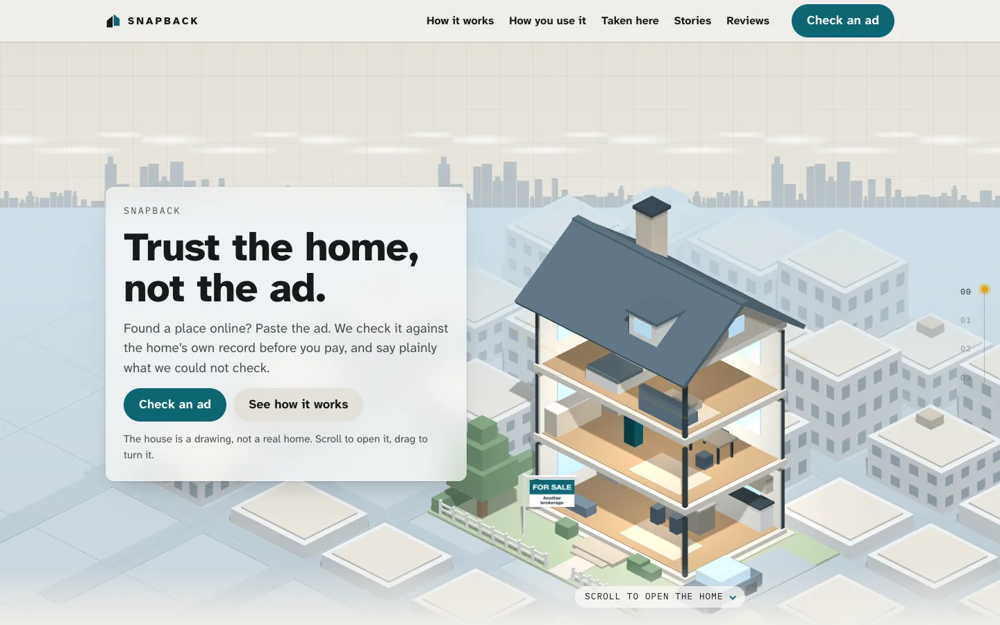

## At a glance

| Track                                            | What we built                                                                                                                                   | Where to see it (URL path)                  | Result (number, n, label)                                                                                                                     |
| ------------------------------------------------ | ----------------------------------------------------------------------------------------------------------------------------------------------- | ------------------------------------------- | --------------------------------------------------------------------------------------------------------------------------------------------- |
| CoStar: "Inside and Out: AI for the Built World" | The ad's photos placed inside the building's Matterport 3D scan, checked against CoStar's property record                                       | `/case/7Q2M/twin` (sample case)             | 43 of 48 real listing photos in the right home, 0 in a wrong one (n = 48 photos, LIVE); 0 of 30 decoys passed (n = 30, LIVE)                  |
| Amazon: Best Practical AI Innovation             | One verdict, the top two reasons and one next step, in the place the ad arrived                                                                 | `/home`                                     | Tampered copies of a real listing caught 6 of 6 for each change (n = 6 photos per change, LIVE)                                               |
| LangChain: Best use of deepagents                | A Planner with a check team of sub-agents, each with one read-only tool; up to 2 follow-up checks tied to open gaps; a next step behind Approve | `/case/7Q2M/twin` (check team)              | Planner done in a median 22.9 s in the background; the report never waits (n = 5 timed runs, FIXTURE)                                         |
| Arlequin AI Track 1: AI-Driven Forensics         | A ring finder that links ads by reworded text, photos, phones and wordings, with a case file per group                                          | `/investigate`                              | 10 of 10 seeded rings flagged, median 2.5 days after a ring's first ad; 0 of 2,684 honest ads flagged (n = 3,039 ads over 90 days, SYNTHETIC) |
| Photon: Build a Messaging Agent using Photon 2.0 | The same check in iMessage on Photon 2.0: send the ad, get the verdict in the thread                                                            | iMessage (allowlisted threads; no web path) | 10 of 11 right, replies in 0.38 to 4.44 s (n = 10 test ads through a test client, FIXTURE)                                                    |

Send SNAPBACK the ad you found, by iMessage or in the one box on the web: a link, its text or
screenshots. It checks the place, the person and the price against the home's own record, gives you
a short report with one verdict, and hands you back to the real listing and the office on record.
Code sets every verdict. SNAPBACK never pays, books or sends anything for you.

<p align="center">
  <a href="https://youtu.be/XN3aK8T2BJo">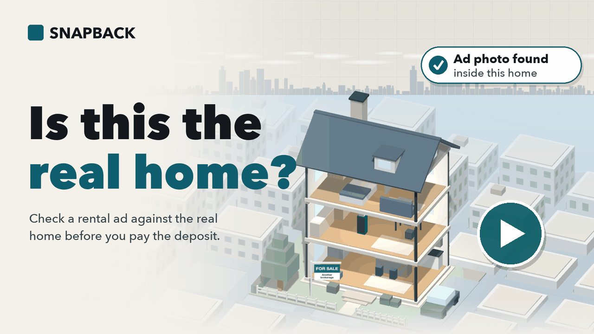</a>
</p>

[At a glance](#at-a-glance) · [The problem](#the-problem) · [How it works](#how-it-works) · [What's inside](#whats-inside) ·
[Results](#results) · [Architecture](#architecture) · [Quick start](#quick-start) ·
[Honest limits](#honest-limits) · [Team](#team)

## The problem

Rental scams copy a real home's photos. The home is real; the person and the offer are fake.

In February 2025 a renter near Houston paid $2,200 in rent and deposit for a house found on
Craigslist. Two days later the real owner, a rental company, said the person who took the money did
not own the house (ABC13 Houston, Feb 15 2025).

The FTC counts nearly **65,000** rental-scam reports and about **$65 million** lost from Jan 2020 to
Jun 2025, and says its count "likely reflects only a fraction of the actual harm".

<details>
<summary>More numbers and their sources</summary>

| Number                                                                                                | Source                                                                                                                                                                                       |
| ----------------------------------------------------------------------------------------------------- | -------------------------------------------------------------------------------------------------------------------------------------------------------------------------------------------- |
| Nearly **65,000** rental-scam reports and about **$65 million** lost, Jan 2020 to Jun 2025            | [FTC Data Spotlight, Dec 22 2025](https://www.ftc.gov/news-events/data-visualizations/data-spotlight/2025/12/rental-scams-hit-home-65-million-reported-losses)                               |
| That is about **32 reports a day**                                                                    | Our arithmetic on the FTC figure (65,000 reports over 2,008 days)                                                                                                                            |
| About half of rental scams in the 12 months to Jun 2025 began with a fake Facebook ad                 | FTC Data Spotlight, Dec 22 2025                                                                                                                                                              |
| Only about 1 in 20 fraud victims reports it (4.8 percent)                                             | A study cited by the FTC (Anderson 2021)                                                                                                                                                     |
| **$275,110,419** lost by **12,368** people to real estate fraud in 2025, up 58 percent on 2024        | [FBI IC3 2025 Annual Report](https://www.ic3.gov/AnnualReport/Reports/2025_IC3Report.pdf) (published Apr 2026). This covers all real estate fraud, rentals included, not rentals alone       |
| About **$18.7 billion** a year in deposits, first month's rent and application fees, paid before keys | **Our estimate**: 10.2 million renter moves a year (Census HVS Q3 2026; 22 percent moved, ACS 2023 via Zillow) times about $1,835 paid up front (Zillow Consumer Housing Trends Report 2025) |

</details>

## How it works

**1. Send the ad.** Text it to SNAPBACK in iMessage, or paste it in the one box on the web: words,
screenshots, or both.

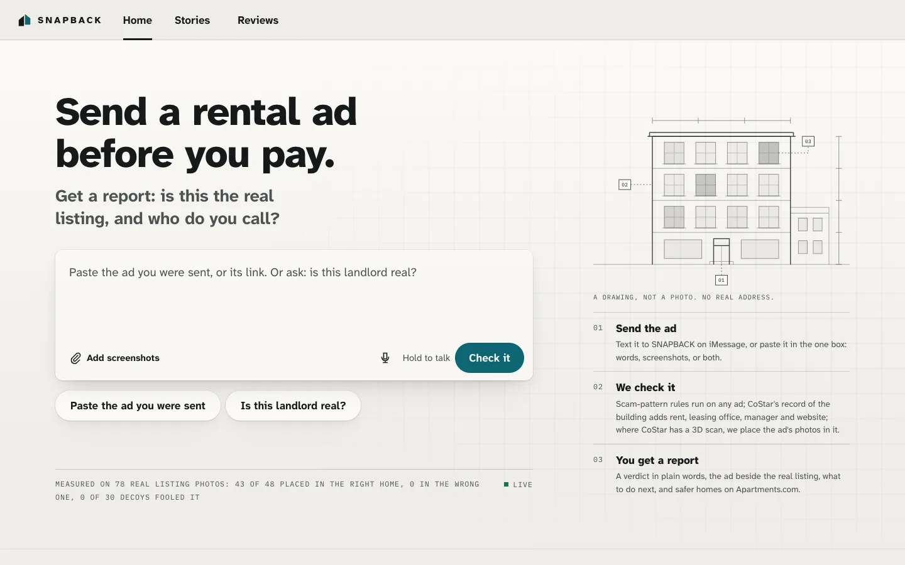

**2. We check it.** Each check reads one source, writes one line on the report, and names where its
fact came from. The report sorts them into three rows.

- **The place: is this the real home?** CoStar's record of the building (address, units and floor
  plans, and whether the home is listed for sale on Homes.com while the ad offers it for rent). The
  ad's photos are matched against the building's Matterport 3D scan: "Taken in this building (3 of
  3 photos)" or "Taken in a different building. Red flag." A loose match gets a hold line, because
  the photo may be edited or made by AI.
- **The person: are you talking to the people who rent it?** The ad's phone is compared, as a keyed
  hash, with the leasing office on CoStar's record; the report says yes or no and never shows the
  digits. A lookalike link to the building's website is a red flag. Public records fill in: the
  county owner of record (Harris County), the Texas Real Estate Commission licence list, the Texas
  Comptroller's company check, HUD's manager record and the website's domain age. You can also ask
  the poster for a fresh photo of a spot in the home; a copy of a listing photo is caught.
- **The price: is the deal or the ask a warning sign?** The rent is compared with the rents on
  record and HUD's typical rent for the ZIP code and bedroom count. Only a rent far below the
  building's lowest is flagged, so honest discounts pass. The ad's own words are read for the
  classic asks: "Zelle before a viewing. Red flag."

**3. You get one verdict.** **Hold off for now**, **Don't pay. Something here doesn't match.**,
**Could not place these photos** or **Checks passed. Still follow the two rules.** "Don't pay" needs
proof: a listing photo taken in a different property, or a reply that copies one of the ad's own
photos. A for-sale listing, a phone that isn't the office's or a name that isn't the owner's holds
the payment but never says "Don't pay" alone. SNAPBACK never calls a named person a scammer.

| The report (sample case 7Q2M, FIXTURE)                                                         | On a phone                                                                                   |
| ---------------------------------------------------------------------------------------------- | -------------------------------------------------------------------------------------------- |
| 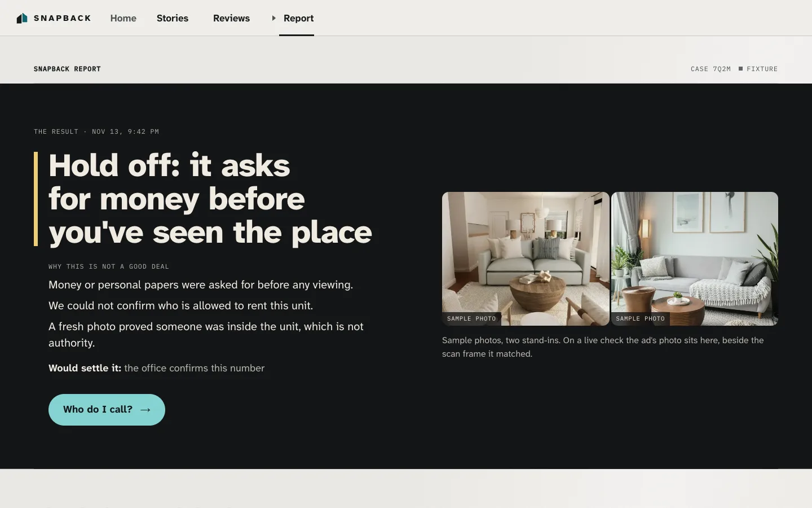 | 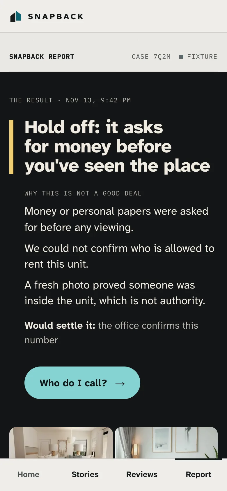 |

**4. Then the hand-off.** The report shows the ad beside the real listing, with a "See the real
listing" link to it on Apartments.com, and the office on record to call. A Hold or unverified report
names the one fact that would settle it, for example "the office confirms this number". When a
listing is being copied, SNAPBACK drafts a note to that office. Every draft says "Draft, not sent.
You send it."

**5. A Planner works the open gaps, and you approve the next step.** A LangChain deepagents Planner
runs on every case in the background. It writes a todo plan, hands each check family to its own
member of the check team, picks up to 2 follow-up checks from a fixed menu (each tied to one open gap
on the report; a pick that names no open gap is refused), and drafts one next step. That step sits
behind **Approve** and **Edit**. Approve gives "Ready: you send it" and a Copy button. The report
never waits on the Planner, and the verdict code never reads its picks.

## What's inside

|                                                                                                                                                                                                                                              |                                                                                                                                                                                                                                                                                         |
| -------------------------------------------------------------------------------------------------------------------------------------------------------------------------------------------------------------------------------------------- | --------------------------------------------------------------------------------------------------------------------------------------------------------------------------------------------------------------------------------------------------------------------------------------- |
| **Walk it first.** The ad's photo fades over the building's 3D scan, beside a check team you can watch work: who ran, who was skipped, and why. 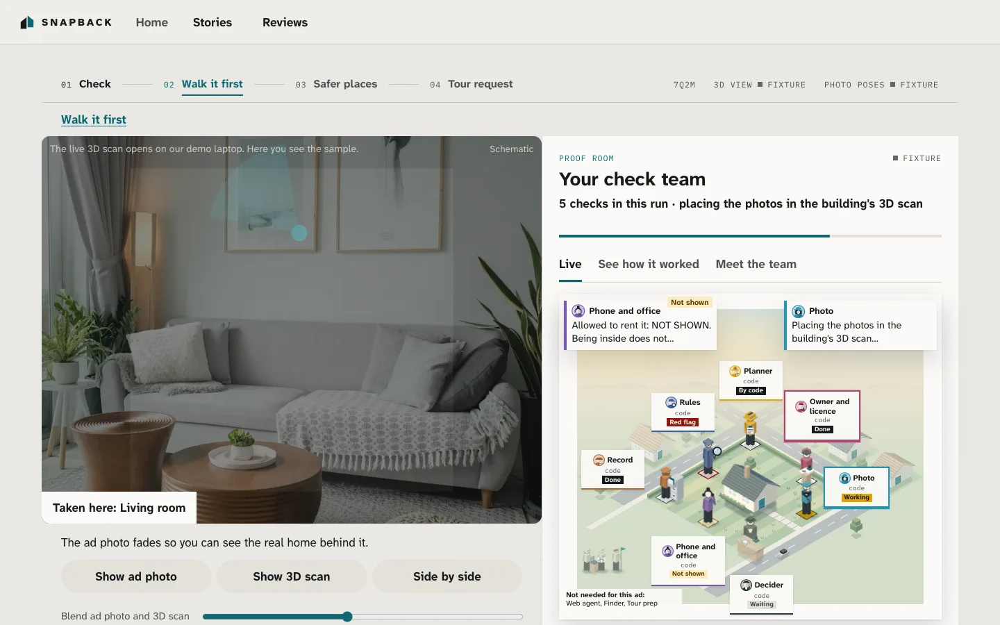 | **The city map.** Every researched place in Houston, by where it is, with a brief to narrow them down. 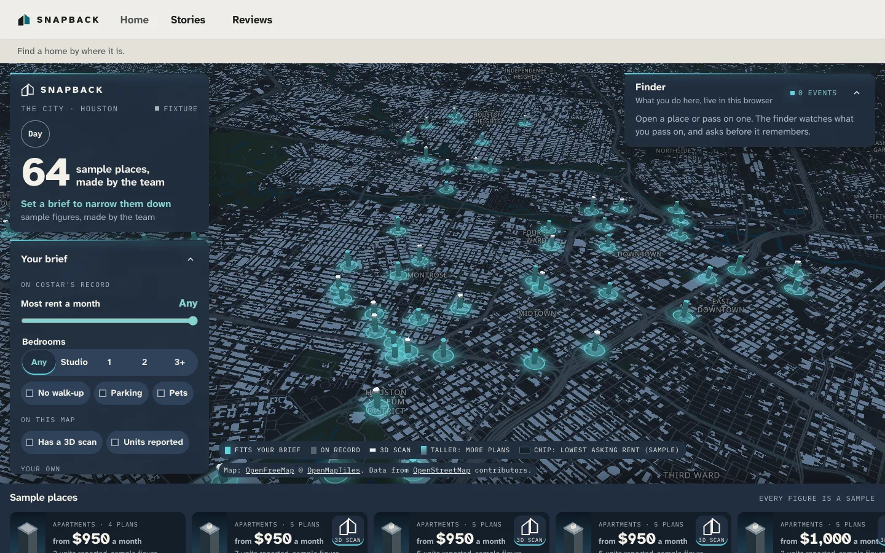                                                                                                           |
| **The Finder.** Say or type what you need. A code rule offers to keep what it can read, and keeps nothing until you say yes. 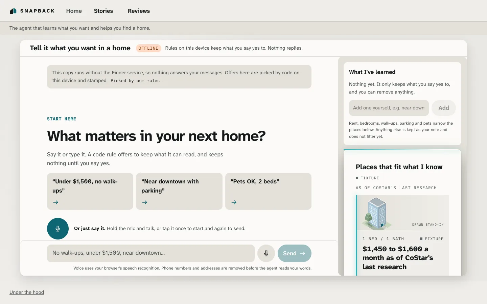                            | **The ring finder.** Links ads by reworded text, shared photos, phone numbers and wordings, and plays a 90-day stream so you can watch each ring form. SYNTHETIC data. 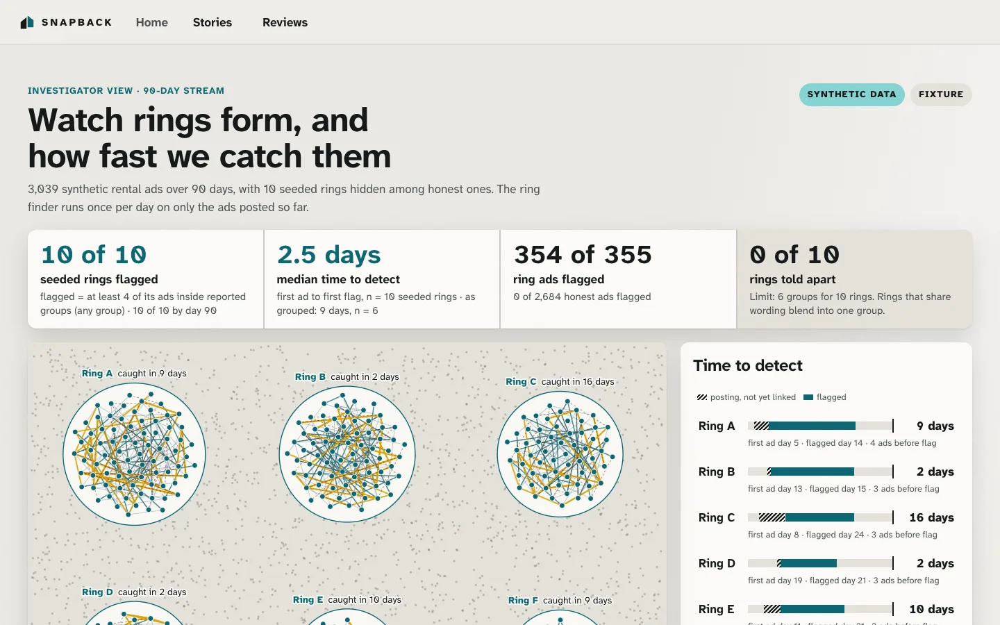                         |
| **A case file per ring.** Which phones, photos and wordings tie the ads together, laid out for a fraud report. SYNTHETIC data. 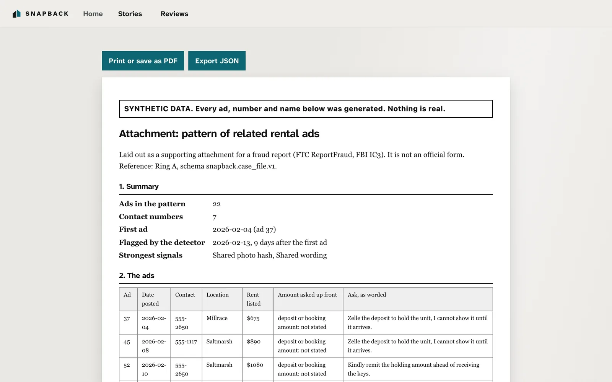                                           | **Spot the scam.** Four composed ads, one per screen, Looks fine or Hold off. The reveal shows what the real rules engine held off on. Every ad is SYNTHETIC. 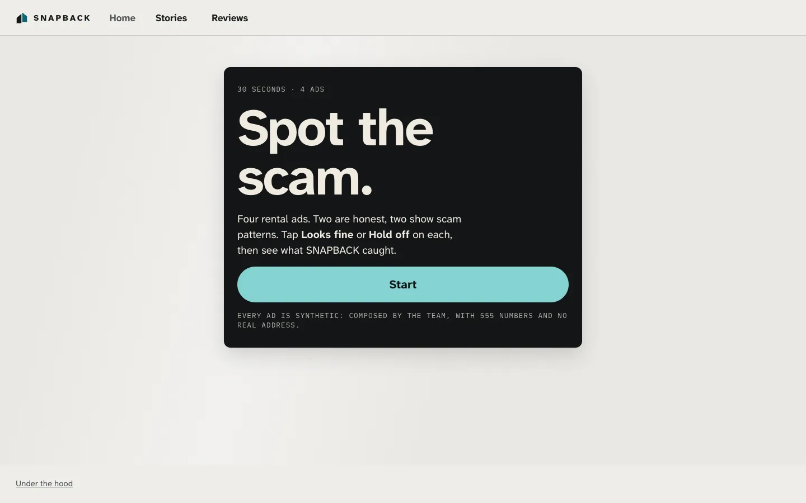                                                                   |
| **Under the hood.** One panel per technology, each eval beside its baseline on the same set, with n and its label. Rows with no baseline say "None measured". 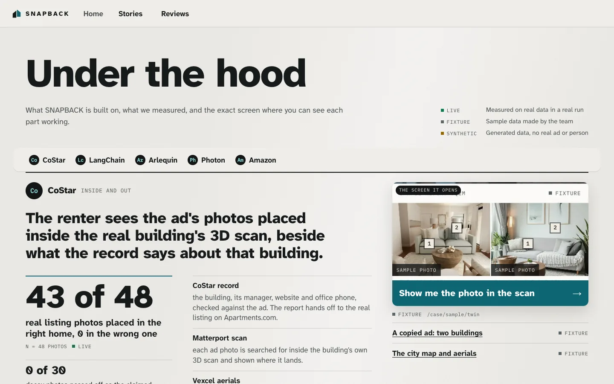                    | **In iMessage, it is a conversation.** An instant "checking" line, then a short report with a picture of the card. "Why?", "Who do I call?" and "Is it safe?" answer from the same case. 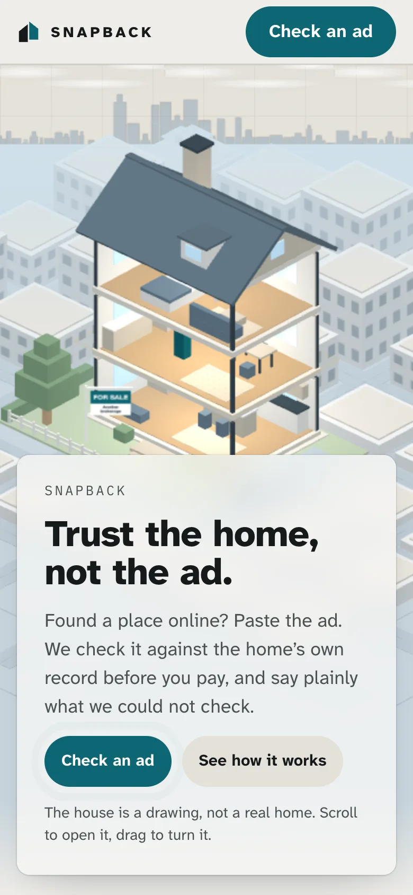 |

**More in iMessage.** Each red flag links to its proof on the case card, at most 3 links per reply.
It remembers your language, budget and beds for 30 days, and "forget me" deletes them. A voice memo
in gets a spoken reply of 15 seconds or less, which never reads out a phone number, a rent or a link.
Only allowlisted threads are answered, and it never texts first.

**MCP server.** `src/snapback/mcp_server.py` exposes SNAPBACK as tools for any AI assistant:
`snapback_check_listing`, `snapback_get_verdict`, `snapback_why`, `snapback_what_to_do`,
`snapback_find_places`, `snapback_accept_preference`, `snapback_walk_summary` and
`snapback_draft_tour_request` (a draft only). It is a thin client over the API, so every rule and
verdict stays in code. Setup: [docs/mcp.md](docs/mcp.md).

## Results

Every number comes from merged code and its eval files, with its n. **LIVE** means real CoStar kit
data or real listing photos. **FIXTURE** means team-made data through the real pipeline.
**SYNTHETIC** means generated data.

| What                                                                                            | Result                                                                                         | n                          | Label     |
| ----------------------------------------------------------------------------------------------- | ---------------------------------------------------------------------------------------------- | -------------------------- | --------- |
| Real listing photos placed in the right home (`eval/locate_real.csv`, re-measured Nov 15)       | 43 of 48 in the right home, 0 in a wrong home                                                  | 48 photos                  | LIVE      |
| Decoy photos placed in the claimed building                                                     | 0 of 30                                                                                        | 30 decoys                  | LIVE      |
| Tampered copies of a real listing: phone changed, "Zelle before the tour" added, lookalike link | Each change caught 6 of 6                                                                      | 6 photos per change        | LIVE      |
| Ring finder over a 90-day stream of 3,039 ads with 10 seeded rings                              | 10 of 10 rings flagged, median 2.5 days after a ring's first ad; 0 of 2,684 honest ads flagged | 10 rings, 2,684 honest ads | SYNTHETIC |
| Ring finder on reworded ads                                                                     | 9 of 10 rings flagged, where a keyword search found 0 of 10                                    | 10 rings, 2,684 honest ads | SYNTHETIC |
| Planner in the background                                                                       | Median 22.9 s, and the report returns without waiting                                          | 5 timed runs               | FIXTURE   |
| iMessage reply sweep (a test client in place of a phone)                                        | 10 of 11 right, replies in 0.38 to 4.44 s                                                      | 10 test ads                | FIXTURE   |

<details>
<summary>More measurements</summary>

| What                                                                                                   | Result                                                                                                                                                                                       | n                     | Label     |
| ------------------------------------------------------------------------------------------------------ | -------------------------------------------------------------------------------------------------------------------------------------------------------------------------------------------- | --------------------- | --------- |
| Tamper test on 3D scan renders                                                                         | Each change caught 2 of 2                                                                                                                                                                    | 2 renders, per change | LIVE      |
| Batch run: composed ads and labelled messages through the real pipeline (`eval/ads_results.csv`, #262) | 117 of 123 handled as expected, including 43 of 43 clean messages left alone                                                                                                                 | 123                   | FIXTURE   |
| Planner and report latency (#273, real model runs)                                                     | Report returns in 0.03 to 0.09 s without waiting; agent done in a median 22.9 s, no fallbacks                                                                                                | 6 cases, 5 timed runs | FIXTURE   |
| Ring finder on reworded ads, phone and photo-link fallback on (#312)                                   | Only 171 of 355 ring ads (48%) caught once reworded                                                                                                                                          | 355 ring ads          | SYNTHETIC |
| Ring finder on a 301-ad corpus with 4 seeded rings                                                     | 4 of 4 rings, 0 of 244 honest ads flagged; a keyword search found 0 of 4                                                                                                                     | 301 ads               | SYNTHETIC |
| Vexcel aerial matcher v2, SIFT with RANSAC (`eval/vexcel/results.json`)                                | 52 of 54 placed right (right building 23 of 24, next-door 17 of 18, other wrong 12 of 12). Held-out half, with thresholds tuned on the other half: right building 11 of 12, next-door 8 of 9 | 54 cases              | LIVE      |
| Mirrored listing photos                                                                                | 4 of 18 placed, none in a wrong home                                                                                                                                                         | 18 photos             | LIVE      |

</details>

## Sponsor tracks

| Track                                            | What SNAPBACK brings to it                                                                                                                                                                                                                  |
| ------------------------------------------------ | ------------------------------------------------------------------------------------------------------------------------------------------------------------------------------------------------------------------------------------------- |
| Business and Enterprise                          | Turns records a business already keeps (property record, office phone, website, rents, 3D scan) into a check that protects the renter before money moves, and drafts a note to the office when a listing is being copied                    |
| CoStar: "Inside and Out: AI for the Built World" | Two layers decide the verdict: CoStar's record of the building and the Matterport 3D scan the ad's photos are placed in. Vexcel aerials appear on the place sheet as evidence only. Every report ends at the real listing on Apartments.com |
| Amazon: Best Practical AI Innovation             | A renter about to send a deposit asks one question where the scam arrives, in iMessage, and gets one verdict, the top two reasons and one next step                                                                                         |
| LangChain: Best use of deepagents                | A Planner with `write_todos` and a check team of sub-agents, each with one read-only tool, bounded to 2 follow-up checks tied to open gaps, traced in LangSmith                                                                             |
| Arlequin AI Track 1: AI-Driven Forensics         | The ring finder: reworded-text, photo, phone and wording links, Louvain communities, a 90-day stream and a case file per group                                                                                                              |
| Photon: Build a Messaging Agent using Photon 2.0 | A Node sidecar on Photon 2.0 (the Spectrum SDK): text, screenshots, photos or a voice memo in, a short report and a picture of the card back in the same thread                                                                             |

## Architecture

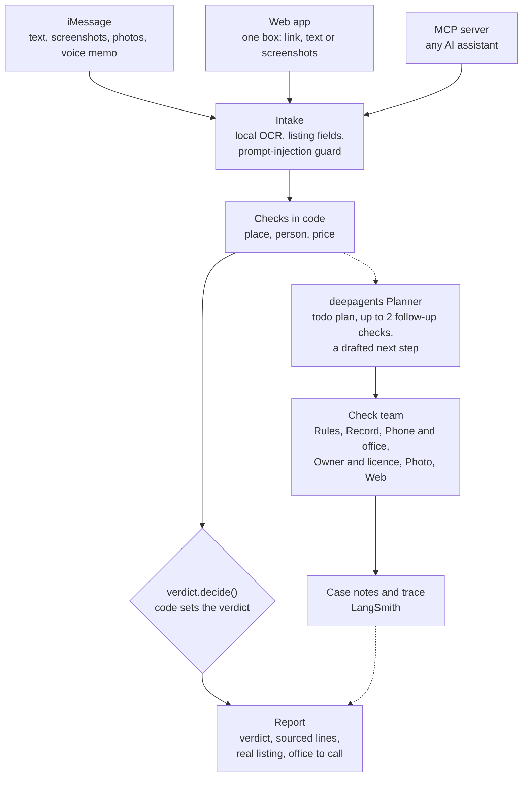

1. **Intake.** The ad arrives by iMessage (a Node sidecar on Photon 2.0, the Spectrum SDK), by the
   web app, or through the MCP server. Screenshots are read with local OCR (RapidOCR on ONNX
   Runtime), and the listing fields are pulled out behind a prompt-injection guard.
2. **The checks run in code.** Each one reads its source and returns evidence with its origin.
3. **Code sets the verdict.** `verdict.decide()` in `src/snapback/verdict.py` turns that evidence
   into one verdict. It is the only place a verdict is chosen. No model sees or sets it.
4. **Photo placement.** DINOv2 retrieval over views rendered from the Matterport 3D scans, then DISK
   and LightGlue matching (kornia) with RANSAC and a spatial spread check.
5. **The Planner works the open gaps** in the background with a hard time limit. Each check team
   member has one read-only tool and writes its findings as notes in the agent file system. The
   trace shows each member's model, tools, findings and time, and links out to the LangSmith run.
6. **The ring finder** (`src/snapback/forensics/`) uses concept-folded TF-IDF, a link graph of ads,
   photos, phones and wordings, and Louvain communities. Every finding carries its evidence: ad ids,
   the matched sentence, photo ids and a score.

| Path                         | What it is                                                                        |
| ---------------------------- | --------------------------------------------------------------------------------- |
| `src/snapback/verdict.py`    | Evidence in, verdict out. Pure code, no model                                     |
| `src/snapback/agent/`        | Case runner, intake, rules, deepagents graph and sub-agents, follow-ups, trace    |
| `src/snapback/adapters/`     | CoStar records, Matterport, Vexcel, Harris County owner roll, TREC, Texas records |
| `src/snapback/public/`       | HUD rents, Census address check, domain age (RDAP), reverse image search          |
| `src/snapback/vision/`       | Photo placement in 3D scans: DINOv2 retrieval, DISK and LightGlue, RANSAC         |
| `src/snapback/forensics/`    | The ring finder, its case files and its synthetic data generator                  |
| `src/snapback/api/`          | FastAPI: cases, report, card image, trace stream, search, drafts                  |
| `src/snapback/mcp_server.py` | MCP server over the API                                                           |
| `apps/web/`                  | Vite, React and TypeScript web app, with MapLibre                                 |
| `apps/sidecar/`              | iMessage sidecar on Photon 2.0, with voice                                        |

## Quick start

Needs [uv](https://docs.astral.sh/uv/), Python 3.12, Node 22 and npm.

```bash
make setup               # uv sync + npm install
cp .env.example .env     # fixture mode by default; needs no keys
make api                 # API on http://localhost:8000
make web                 # web app on http://localhost:5173, in a second terminal
```

Fixture mode (`SNAPBACK_DATA_SOURCE=fixture`, the default) runs on synthetic, team-made data, and
every screen and number says FIXTURE. To see staged cases end to end:

```bash
uv run python -m snapback.agent.demo   # prints the staged cards
DEMO_CASE=b make api                   # every new case runs on staged case b
```

Optional extras: `uv sync --extra intake` adds local OCR for screenshots, `--extra agent` adds the
deepagents Planner, and `--extra vision` adds the photo matcher (torch, kornia, FAISS, OpenCV).
`make sidecar` runs the iMessage sidecar and `make mcp` runs the MCP server on stdio.

`make check` runs what CI runs: the repo hygiene guard, ruff, ESLint, Prettier, TypeScript, pytest
and the web and sidecar tests. `make eval` writes `eval/results.csv` and runs the regression gate.

<details>
<summary>Environment variables</summary>

Names only; put values in `.env`, which is never committed. `.env.example` documents most of them,
and `src/snapback/settings.py` has the rest.

| For                         | Variables                                                                                                                                       |
| --------------------------- | ----------------------------------------------------------------------------------------------------------------------------------------------- |
| Mode                        | `SNAPBACK_DATA_SOURCE`, `DEMO_CASE`, `SNAPBACK_SHOW_RECORD_FIGURES`                                                                             |
| Planner and tracing         | `SNAPBACK_AGENT`, `ANTHROPIC_API_KEY`, `LANGSMITH_API_KEY`, `LANGSMITH_PROJECT`                                                                 |
| CoStar kit and its partners | `COSTAR_KIT_URL`, `COSTAR_KIT_ZIP`, `COSTAR_ZIP_PASSWORD`, `MATTERPORT_API_KEY`, `MATTERPORT_API_TOKEN`, `VEXCEL_API_KEY`                       |
| Web checks                  | `SNAPBACK_WEB_CHECKS`, `BRIGHTDATA_API_TOKEN`, `APIFY_TOKEN`, `BROWSER_USE_API_KEY`, `SERPAPI_API_KEY`                                          |
| iMessage and voice          | `SPECTRUM_PROJECT_ID`, `SPECTRUM_PROJECT_SECRET`, `SIDECAR_ALLOWED_THREADS`, `SIDECAR_RENTER_SALT`, `ELEVENLABS_API_KEY`, `ELEVENLABS_VOICE_ID` |
| Safety                      | `SNAPBACK_PHONE_SALT`, `SNAPBACK_DAILY_LIMIT`                                                                                                   |

**LIVE mode** (`SNAPBACK_DATA_SOURCE=live`) reads the CoStar kit from `data/` with your own keys.
Each person accepts the kit's terms for themselves. `python3 scripts/probe_kit.py` prints field
names and counts only, never record values.

</details>

<details>
<summary>Reproduce every number</summary>

Run from the repo root after `make setup`. **Kit** means it needs CoStar's sponsor kit, which is not
in this repo (see `DATA_USE.md`), or a key you hold. Rows marked **Open** run on what is committed.
Where no script exists we say so.

| Row                                                    | Command                                                                                                                                          | Needs                                                                                                                                              |
| ------------------------------------------------------ | ------------------------------------------------------------------------------------------------------------------------------------------------ | -------------------------------------------------------------------------------------------------------------------------------------------------- |
| Real photos placed in the right home (43 of 48)        | `make eval-locate-real`                                                                                                                          | **Kit** (listing photos and Matterport index), `--extra vision` and `make prefetch-weights`                                                        |
| Decoy photos (0 of 30)                                 | `make eval-locate-real` (same run writes the decoy row)                                                                                          | Same as above                                                                                                                                      |
| Tamper test (6 of 6, 2 of 2)                           | No script. Run by hand: edit a real listing's phone, add a "Zelle before the tour" line, or swap in a lookalike link, then paste it into the app | **Kit** and a running `make api`; counts are in `docs/devpost.md`                                                                                  |
| Batch of composed ads (117 of 123)                     | `make eval-ads`                                                                                                                                  | **Open** (FIXTURE). With the kit it writes `data/eval/ads_results.live.csv` instead                                                                |
| Planner in the background (22.9 s)                     | No script. Timed by hand on `make api` with `uv sync --extra agent`, reading the case timeline                                                   | Model key in `.env`; **Kit** for the LIVE cases                                                                                                    |
| Ring finder over 90 days (10 of 10, 0 of 2,684)        | `uv run python -m snapback.forensics.detect`                                                                                                     | **Open** (SYNTHETIC); rewrites `fixtures/forensics/stream_timeline.json`                                                                           |
| Ring finder on reworded ads (9 of 10, keyword 0 of 10) | `PYTHONPATH=src uv run python -m snapback.forensics.paraphrase`                                                                                  | **Open** (SYNTHETIC); rewrites `eval/forensics/paraphrase_results.json`                                                                            |
| Ring finder on 301 ads (4 of 4, keyword 0 of 4)        | `uv run pytest tests/test_forensics.py`                                                                                                          | **Open** (SYNTHETIC); the test asserts 4 of 4 rings and that the keyword baseline finds under half; the exact 0 of 4 is in the `evaluate()` output |
| Vexcel aerial matcher (52 of 54)                       | `uv run python scripts/measure_vexcel.py --mode live`                                                                                            | **Kit** and a Vexcel key for LIVE; without them `--mode fixture` runs the committed synthetic set, which is not this row                           |

`make eval` also rewrites `eval/results.csv` and runs the regression gate against
`eval/baseline.csv`. Counts only are written to the eval files; no listing text, phone or photo.

</details>

## Honest limits

- **Aerials are evidence only.** The v2 aerial matcher scored 52 of 54 (LIVE), but on the held-out
  half one next-door building would still pass (8 of 9), just under our 90 percent bar. So the
  aerial is shown on the place sheet and is not in the verdict. Matching building footprints is
  next.
- **Right home, not right room.** Photo placement is scored by home. The room is not measured, and
  we don't claim it.
- **Mirrored photos mostly stop matching** (4 of 18 placed, LIVE). They were never placed in a wrong
  home, and the other checks still run.
- **Not every home has a scan or a record.** Without a scan the photo row says "Not checked", and
  the person and price rows run on public records. HUD's rent cutoff is not measured yet.
- **Houston and Texas first.** Search, the owner roll and the licence list cover Houston and Texas.
- **The ring finder flags rings; it does not yet tell them apart.** The 10 seeded rings land in 6
  groups, and 0 of 10 is a group of its own at a 70 percent overlap bar (SYNTHETIC,
  `eval/forensics/paraphrase_results.json`). Its data was built alongside it, so its numbers show
  the method works on rings shaped like these, not accuracy on real listings.
- **One miss in the iMessage sweep.** The 1 of 11 it got wrong was a lookalike link in a text-only
  ad.
- **iMessage answers allowlisted threads only.** It never texts first, so a stranger's phone gets no
  reply until its thread is added.
- **The public site shows the sample case.** The screenshots here are from
  [snapback-navy.vercel.app](https://snapback-navy.vercel.app) and show sample data (FIXTURE or
  SYNTHETIC), with 555 numbers and no real address. Live checks with the CoStar kit run on our demo
  laptop.

## Data and privacy

The full account is in [DATA_USE.md](DATA_USE.md).

| Where it goes                                | What is sent                                                                                                                                           |
| -------------------------------------------- | ------------------------------------------------------------------------------------------------------------------------------------------------------ |
| Stays on our machine                         | CoStar kit records, Matterport 3D scans and Vexcel imagery. Photo matching and OCR run locally                                                         |
| The language model (Anthropic Claude)        | The renter's own text and yes/no facts the code derived. Never kit rows, record figures, photos or addresses                                           |
| LangSmith                                    | The Planner's trace: the same text and derived facts the model saw                                                                                     |
| Web checks (Bright Data, Apify, Browser Use) | Small derived values: the record's website host, the ad link's host, a short phrase of the ad with no contact details, the rounded area, the bed count |
| Reverse image search (SerpApi)               | At most 2 public photo links found in the ad text. Never an uploaded file                                                                              |
| ElevenLabs                                   | The voice memo, and the spoken reply's text (which never holds a phone number, a rent or a link)                                                       |
| Photon (iMessage)                            | The messages in allowlisted threads. Thread ids are kept as keyed hashes                                                                               |

- **CoStar record figures never go to an outside model.** Rents and unit counts from the record
  show only on a local LIVE demo with `SNAPBACK_SHOW_RECORD_FIGURES` on, never on a public host, the
  card image, MCP or iMessage. The "See the real listing" link shows either way.
- **Sponsor data stays in `data/`,** which is git-ignored. `make hygiene` fails if anything there is
  tracked, and the kit is deleted by the date its terms set (Nov 15 2026, 16:00).
- **Phone numbers are compared as keyed hashes,** and the report says yes or no, never the digits.
  Every phone number in the fixtures is a 555 number.
- **Names stay out.** A private owner reads "a private owner". A company is named only when it
  matches one we already know. No real addresses or renter names are in code, fixtures, tests or
  docs. No sponsor image or record appears in this repo.
- **Photos are kept as hashes, never pixels,** for 7 days.
- **Delete anytime.** `make purge` deletes everything in `data/`. To remove one renter's cases:

  ```bash
  uv run python -m snapback.safety delete-case <case_id>
  uv run python -m snapback.safety delete-renter <renter_id>
  ```

## What a realtor said

A realtor reviewed SNAPBACK as rental tour prep, with scam safety built in: find a place, see it on
the map, walk it in 3D before you go, and check the ad before any money moves.

> "If he can add in additional safety features for preventing further scams and financial scams, I
> think this would be a very good app to have in the marketplace."
>
> Ashwin Veeravalli, Realtor, The Agency, Los Gatos CA

## Team

- Vidyut Sriram ([@vs-githjk](https://github.com/vs-githjk))
- Dev Pratap Singh ([@DevSingh05](https://github.com/DevSingh05))
- Jeffrey Gao ([@jeffrey-g05](https://github.com/jeffrey-g05))
- Rishit Rai ([@RishitRai](https://github.com/RishitRai))

Read [AGENTS.md](AGENTS.md) before contributing. It holds the hard rules: no sponsor data or secrets
in git, code sets the verdict, LIVE or FIXTURE on everything, no number before it is measured, and
never call a named person a scammer.

## Credits

CoStar property records and Homes.com listings, Matterport 3D scans and Vexcel aerial imagery from
the CoStar kit, used under its terms; LangChain deepagents and LangSmith; Photon 2.0 (the Spectrum
SDK) for iMessage; Anthropic Claude; ElevenLabs; Bright Data, Apify and Browser Use; SerpApi. Arlequin
AI's forensics brief shaped the ring finder. Public data from the Harris County Appraisal District,
the Texas Real Estate Commission, the Texas Comptroller, HUD, the US Census Bureau and the City of
Houston. Models and libraries: DINOv2 (Meta, Apache 2.0), DISK and LightGlue through kornia (Apache
2.0), RapidOCR on ONNX Runtime, MapLibre. Full list: [docs/CREDITS.md](docs/CREDITS.md).

## Rights

Rights in this project are assigned to CoStar Realty Information, Inc. under the HackPrinceton Fall
2026 hackathon agreement. No licence is granted. Third-party libraries remain under their own
licences.

---

Built at HackPrinceton 2026.
